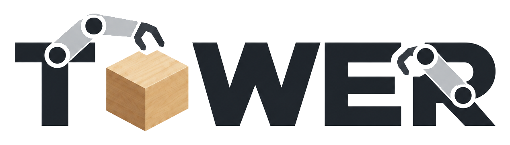
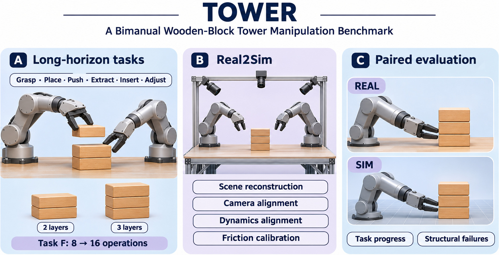

<div align="center">
  <picture>
    <source media="(prefers-color-scheme: dark)" srcset="docs/assets/tower-logo-v1-dark.png">
    <source media="(prefers-color-scheme: light)" srcset="docs/assets/tower-logo-v1.png">
    
  </picture>

  <h1>TOWER: Benchmarking Bimanual Manipulation across Simulation and Reality</h1>
  <p>Long-horizon tower manipulation, from atomic actions to coordinated bimanual tasks.</p>

  <p>
    <a href="docs/index.md">Documentation</a> ·
    <a href="#quick-start">Quick start</a> ·
    <a href="https://huggingface.co/datasets/tower-benchmark/TOWER-Assets">Assets</a> ·
    <a href="https://challenge.tower-benchmark.com">Challenge</a>
  </p>

  <p>
    
    
    
    
    
  </p>
</div>

<p align="center">
  
</p>

**Illustrated overview (AI-generated; not experimental evidence).** (A) Six atomic actions compose long-horizon tasks; increasing tower height extends Task F from 8 to 16 operations. (B) Real2Sim combines scene reconstruction, camera alignment, dynamics alignment and friction calibration. (C) Paired REAL/SIM evaluation examines task progress and structural failures. Hardware and block arrangements are schematic; this illustration does not depict recorded trials or measured results.

TOWER is a robotics simulation benchmark for long-horizon bimanual tower manipulation, with six task families at two tower heights. This distribution provides fixed-scene evaluation, policy integration and operation-level scoring. Public benchmark revision **2026.11.1** uses a redacted scene representation with unchanged physical scenes; see [versioning](docs/reference/versioning.md).

## Highlights

- **12 benchmark variants.** Six task families (A–F), each at two and three layers, test transfer, extraction, insertion, pushdown and tool use.
- **600 fixed evaluation scenes.** Revision `2026.11.1` provides 50 scenes per variant in the `tower-scene-v2` format.
- **GPU simulation.** Isaac Sim 6.1 with GPU PhysX supplies benchmark physics. CPU smoke tests check integration only.
- **Policy integration.** Connect through XPolicyLab WebSocket policy servers, pinned at `tower-1.0.3`, or use the in-process policy interface.
- **Operation-level scoring.** The `bench-2026.11` ruleset detects G/P operations and disturbed blocks; `paper-v1` remains a compatibility ruleset.
- **Verified assets.** Anonymous asset downloads use an immutable revision and manifest SHA-256 digests, with code and asset licenses documented separately.

## Tasks

Planned G/P counts follow the [task registry](docs/concepts/tasks.md). The [scoring reference](docs/reference/scoring.md) defines how grasp, placement and task-specific push operations receive credit.

| Task | Family | 2-layer canonical id | G/P | 3-layer canonical id | G/P |
| --- | --- | --- | ---: | --- | ---: |
| A | Cross transfer | `cross-transfer-2` | 2/2 | `cross-transfer-3` | 3/3 |
| B | Two-block transfer | `two-block-transfer-2` | 4/4 | `two-block-transfer-3` | 6/6 |
| C | Extract and stack | `extract-and-stack-2` | 1/1 | `extract-and-stack-3` | 2/2 |
| D | Lateral insertion | `lateral-insertion-2` | 1/1 | `lateral-insertion-3` | 2/2 |
| E | Layerwise pushdown | `layerwise-pushdown-2` | 3/3 | `layerwise-pushdown-3` | 6/3 |
| F | Tool-assisted extraction | `tool-assisted-extraction-2` | 5/3 | `tool-assisted-extraction-3` | 10/6 |

## Quick start

### CPU installation check

Use Python 3.11 or 3.12 and run from the repository root, following [installation](docs/getting-started/install.md):

```sh
uv sync --locked
uv run --package tower-eval tower smoke
```

This smoke check does not evaluate benchmark physics.

### Set up simulation and assets

Isaac Sim 6.1 needs a separate Python 3.12 environment and compatible GPU and drivers. Follow [Isaac setup](docs/isaac-sim.md) and the [runtime build instructions](docs/reference/bench-public.md) for the simulator, native IK, wheels and release manifest.

[Download and verify assets](docs/guides/evaluate-a-policy.md#download-and-verify-assets), keeping them outside the checkout. Replace `/path/to/assets` with your asset directory:

```sh
uv run python tools/simulator/benchmark_assets.py download --assets /path/to/assets
uv run python tools/simulator/benchmark_assets.py verify --assets /path/to/assets
uv run python tools/simulator/benchmark.py verify --benchmark 2026.11.1 --assets /path/to/assets
```

The first verification checks physical assets; the second also checks evaluation data. Downloads require no login.

### Connect and evaluate a policy

Initialize the pinned integration and check its CPU loopback using the [policy author quickstart](docs/getting-started/quickstart-policy-author.md):

```sh
GIT_LFS_SKIP_SMUDGE=1 git submodule update --init third_party/XPolicyLab
uv sync --locked --package tower-eval --extra xpolicylab
uv run --package tower-eval tower smoke --policy xpolicylab://demo_policy
```

Follow [evaluate a policy](docs/guides/evaluate-a-policy.md) to start your policy server and prepare the runtime. Diagnostic runs are the supported way to test a policy now. Formal runs additionally require a reviewed posture record; the contact-frame references and review tooling are not yet published. The guide explains both paths and their prerequisites.

For an already prepared formal request, the guide's validation and launch commands are:

```sh
uv run python tools/simulator/benchmark.py check-request --request /path/to/new-request/request.json
uv run python tools/simulator/benchmark.py run --request /path/to/new-request/request.json --isaac-python /path/to/isaac/python
```

Keep input identities, resolved configuration, complete recordings and failure status with results. Model weights are not bundled; supply your own compatible policy.

## Documentation

| Guide or reference | What it covers |
| --- | --- |
| [Documentation home](docs/index.md) | Entry points and benchmark scope. |
| [Installation](docs/getting-started/install.md) | Python environments and CPU integration check. |
| [Benchmark user](docs/getting-started/quickstart-benchmark-user.md) | End-to-end evaluation workflow. |
| [Policy author](docs/getting-started/quickstart-policy-author.md) | Pinned serving integration and policy setup. |
| [Contributor](docs/getting-started/quickstart-contributor.md) | Development setup and validation commands. |
| [Evaluate a policy](docs/guides/evaluate-a-policy.md) | Asset verification, requests and runtime execution. |
| [Write a policy server](docs/guides/write-a-policy-server.md) | Serving a compatible policy. |
| [Offline scoring](docs/guides/offline-scoring.md) | Score saved recordings. |
| [Control safety](docs/guides/eef-control.md) | Control modes, bounds and posture requirements. |
| [Task registry](docs/concepts/tasks.md) | Canonical task ids, deadlines and planned operations. |
| [Public runtime](docs/reference/bench-public.md) | Simulator dependencies and release build contract. |
| [Policy interface](docs/reference/policy-interface.md) | Observations, actions and runtime transport. |
| [Scoring](docs/reference/scoring.md) | Operation detection, disturbance and rulesets. |
| [Assets](docs/reference/assets.md) | Locked assets and license guidance. |
| [Versioning](docs/reference/versioning.md) | Software, data and schema identities. |
| [Reproduction](docs/reproduce/benchmark-2026.11.md) | Reporting benchmark measurements separately from paper results. |

## Versions

Use matching runtime and data identities. Package versions below are **development versions**, not a published 1.0 release; see [versioning](docs/reference/versioning.md) and the [changelog](CHANGELOG.md).

| Component | Version or identity |
| --- | --- |
| Public benchmark | `2026.11.1` |
| Scene schema | `tower-scene-v2` |
| TOWER-Assets tag | `benchmark-2026.11.1` |
| TOWER-Assets immutable commit | `d78e4ac0b2bfc1e10a15d31ac7e7d723be2764f1` |
| Isaac Sim | `6.1` (GPU PhysX) |
| XPolicyLab submodule | `tower-1.0.3` |
| `tower-sim` | `0.1.0` (development) |
| `tower-eval` | `0.1.0` (development) |
| `nero-kinematics` | `0.2.0` (development) |

## Repository structure

```text
benchmarks/                 Task registries, protocols and data locks
configs/                    Evaluation configuration
packages/tower-sim/         Simulation runtime and benchmark scenes
packages/nero-kinematics/   Kinematics and robot models
src/tower-eval/             Policy interfaces, evaluation and scoring
third_party/XPolicyLab/    Pinned policy-serving integration
reproduction/paper_metrics/ Paper metric reference implementation
scripts/                   Development and validation utilities
tools/                     Simulator and benchmark command-line tools
tests/                     Integration, contract and documentation tests
docs/                      Guides and reference documentation
```

## Paper

**TOWER: Benchmarking Bimanual Manipulation across Simulation and Reality**

The paper's SIM results used its own evaluation harness, which is not part of this distribution. The [paper metrics reference](reproduction/paper_metrics) provides the metric implementation. Label paper results and public-benchmark results separately: physical scene equivalence alone does not establish equivalence of policies or evaluation protocols. See the [reproduction guidance](docs/reproduce/benchmark-2026.11.md).

## Citation

Use [CITATION.cff](CITATION.cff) for citation information.

## Acknowledgements

TOWER uses XPolicyLab for policy serving and AgileX robot model data. The kinematics implementation draws on the piper_ros algorithm reference, and the default joint-target interpolation reimplements RoboDojo's documented behavior. See [NOTICE](NOTICE) and [THIRD_PARTY_NOTICES.md](THIRD_PARTY_NOTICES.md) for provenance and component-specific terms.

## Contributing

See [Contributing](CONTRIBUTING.md) for development, [Security](SECURITY.md) for vulnerability reporting, and the [Code of Conduct](CODE_OF_CONDUCT.md) for community expectations.

## License

Code is licensed under [Apache-2.0](LICENSE). TOWER-authored assets are licensed under [CC BY 4.0](LICENSE-ASSETS) unless their manifest entry states otherwise. Third-party components retain their own terms; see [NOTICE](NOTICE) and [THIRD_PARTY_NOTICES.md](THIRD_PARTY_NOTICES.md).
